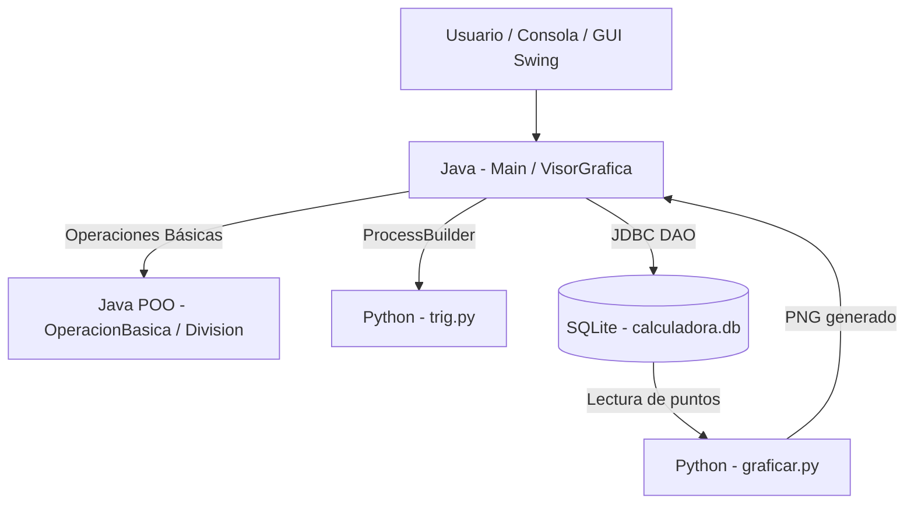

# Proyecto Integrado: Calculadora Científica y Gráfica
### Java + Python + SQLite

Este proyecto integra **Bases de Datos** y **Programación Orientada a Objetos 2 (POO2)** mediante una arquitectura modular donde tres tecnologías se comunican por contratos técnicos formales:
- **Java (POO2):** Interfaz común (`IOperacion`), herencia, polimorfismo, manejo de excepciones y persistencia JDBC mediante el patrón DAO (`CalculoDAO`).
- **Python:** Motor trigonométrico (`trig.py`) y generador de gráficas de curvas en formato PNG con `matplotlib` (`graficar.py`), invocado por Java mediante `ProcessBuilder`.
- **SQLite (3FN):** Catálogo de operaciones, historial completo de cálculos (éxitos y fallos) y persistencia transaccional de series y puntos para graficación.

---

## 🏛️ Arquitectura del Sistema



---

## 📁 Estructura del Repositorio

```text
├── bd/
│   ├── calculadora.db          # Base de datos SQLite activa
│   ├── create_schema.sql       # DDL normalizado en 3FN con restricciones CHECK y FK
│   ├── seed.sql                # Catálogo de 10 operaciones (Básicas y Trigonométricas)
│   ├── pruebas.sql             # 5 pruebas de integridad referencial y de dominio
│   ├── consultas.sql           # Consultas analíticas, historial y GROUP BY
│   └── sql.py                  # CLI auxiliar en Python para ejecutar SQL en Windows
├── python/
│   ├── trig.py                 # Motor de funciones trigonométricas y series (sin, cos, tan, asin, acos, atan)
│   └── graficar.py             # Generador de gráficas PNG leyendo puntos desde SQLite
├── lib/
│   ├── sqlite-jdbc-3.45.3.0.jar # Driver JDBC oficial de SQLite
│   ├── slf4j-api-2.0.13.jar    # API de logging
│   └── slf4j-simple-2.0.13.jar # Implementación de logging
├── src/
│   └── calculadora/
│       ├── Main.java           # Menú interactivo de consola y orquestador
│       ├── dao/
│       │   └── CalculoDAO.java # Persistencia JDBC y transacciones de series
│       ├── modelo/
│       │   ├── IOperacion.java
│       │   ├── OperacionBasica.java
│       │   ├── Division.java
│       │   ├── Suma.java
│       │   ├── Resta.java
│       │   ├── Multiplicacion.java
│       │   └── OperacionTrigonometrica.java
│       └── vista/
│           └── VisorGrafica.java # Ventana gráfica interactiva en tiempo real (Swing)
├── compilar.bat                # Script para compilar las clases Java
├── ejecutar_calculadora.bat    # Script para ejecutar la calculadora interactiva
├── pruebas.bat                 # Suite de automatización de base de datos
├── pruebas_python.bat          # Suite de verificación de contratos Python
└── README.md
```

---

## 🚀 Requisitos y Configuración

1. **Java:** JDK 17 o superior.
2. **Python:** Python 3.10 o superior (disponible con `py` o `python`).
3. **Librerías Python:**
   ```powershell
   py -m pip install matplotlib
   ```

---

## 🛠️ Compilación y Ejecución

* **Compilar:**
  ```powershell
  .\compilar.bat
  ```

* **Ejecutar la Calculadora con Visor Gráfico en Tiempo Real:**
  ```powershell
  .\ejecutar_calculadora.bat
  ```

* **Ejecutar Pruebas Automatizadas de la Base de Datos:**
  ```powershell
  .\pruebas.bat
  ```

* **Ejecutar Pruebas de Contratos de Python:**
  ```powershell
  .\pruebas_python.bat
  ```

---

## 📋 Contratos Técnicos Implementados

1. **Cálculo Único:** `py python\trig.py <fn> <valor> [--modo grados|radianes]`
   - Salida: `OK;<resultado>` o `ERROR;<mensaje>`
2. **Generación de Series:** `py python\trig.py serie <fn> <xmin> <xmax> <paso> [--modo grados|radianes]`
   - Salida: líneas `x;y` (o `x;` en indeterminaciones como $\tan(90^\circ)$).
3. **Renderizado de Gráficas:** `py python\graficar.py <ruta_db> <serie_id> <salida.png> [--punto <x> <y>]`
   - Lee las coordenadas desde la base de datos y genera el PNG resaltando el punto evaluado.
